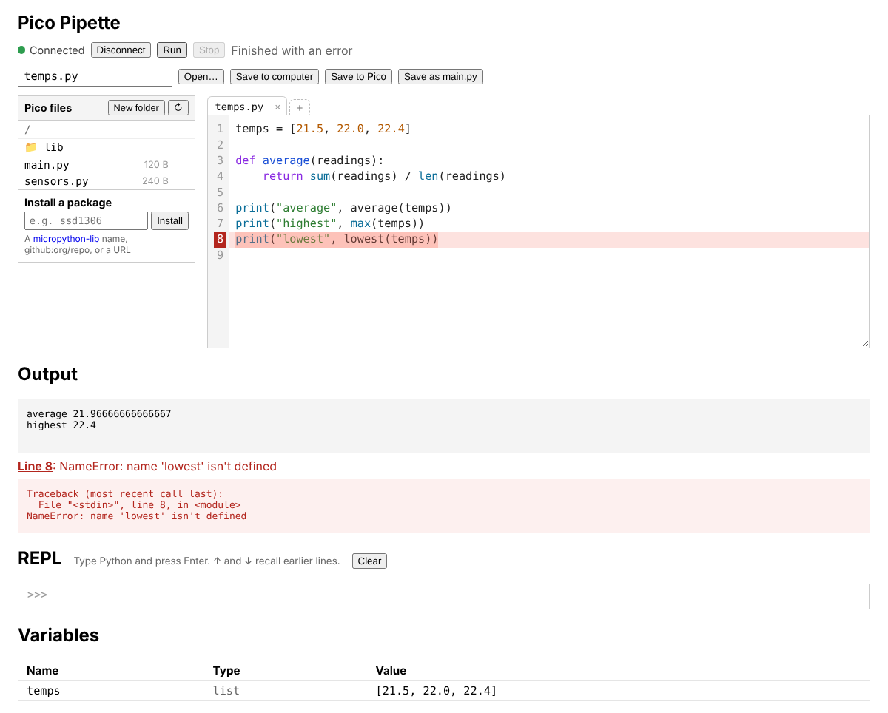

# Pico Pipette documentation

[Open the editor](https://romilly.github.io/pico-pipette/) ·
[View the project on GitHub](https://github.com/romilly/pico-pipette)

Pico Pipette lets you program, debug and manage a Raspberry Pi Pico running MicroPython from a web browser,
with nothing to install. These pages cover using it, putting it in your own web pages, and working on it.

## Tutorials

- [Two Minute Tutorial](two-minute-tutorial.md): connect to your Pico, blink its LED, and see how Pipette shows an error.
- [Five Minute Tutorial](five-minute-tutorial.md): stop a running program, look inside it with the REPL,
  and make it run whenever the Pico powers up.

## How-to guides

- [Put MicroPython on a Pico](../help.html#micropython)
- [Fix connection problems](../help.html#trouble), or let the [connection checker](../check.html) find them
- [Install a package](../help.html#packages), such as a display driver
- [Split a program across several files](../help.html#tabs)
- [Add Pipette to your own web page](embedding.md): a small editor for a lesson, or the whole editor
- [Record a scripted demo](https://github.com/romilly/pico-pipette/blob/main/demo/README.md) of Pipette for a course or video

## Reference

- [User guide](../help.html): everything the editor does, panel by panel
- [The `<pico-pipette>` and `<pipette-ide>` elements](elements.md): attributes, properties, methods and events
- [The modules](modules.md): the JavaScript modules in `src/`, for building your own pages

## Explanation

- [How Pipette works](how-it-works.md): the raw REPL, the port that every board goes through,
  and why there's no server and no build step

## Installation and development

- [Installation](installation.md): nothing to install, but here's how to run your own copy or use the npm package
- [For developers](developers.md): the code's layout, the tests, releasing, and the demo scripts
